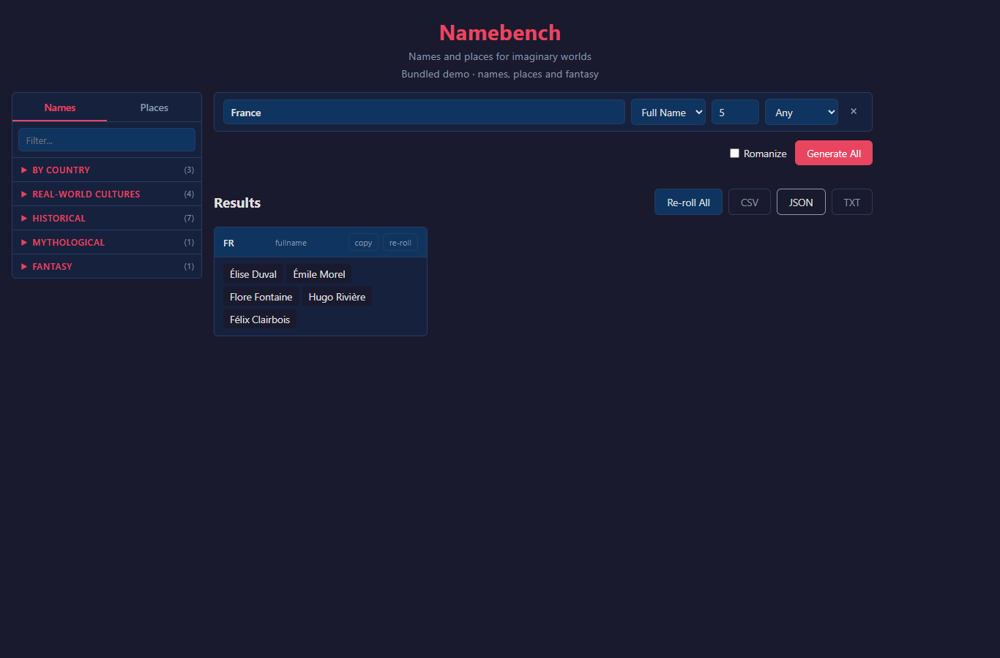

# Namebench

A small, standalone sandbox for personal names and place names. Pick a country, cultural style or fantasy generator, then generate and export a batch.



## Run the demo

Python 3.12 is the validated version. On Windows, double-click **`demo.cmd`**, then open **http://127.0.0.1:5001**. The first launch creates a private virtual environment and installs the pinned dependencies. Keep the terminal open.

```powershell
python -m venv .venv
.venv\Scripts\python.exe -m pip install -r requirements.lock
.venv\Scripts\python.exe -m pip install -e ".[dev]"
.venv\Scripts\python.exe -m namegen demo
```

On Linux/macOS, use `.venv/bin/python` instead. The installed command is `namebench`.

The demo builds a small SQLite database from a bundled, hand-authored sample. It requires no world dataset, scraper, API key or sibling project. Try France, Britain, Japan, fantasy names, place names and JSON/CSV/TXT export. Only a subset of the full style catalogue is represented in this sample.

## Use the world dataset

The full local database is separate from the demo and excluded from Git:

```powershell
.venv\Scripts\python.exe -m namegen demo --database data/names.db
.venv\Scripts\python.exe -m namegen french fullname 5 --json
.venv\Scripts\python.exe -m namegen mongol place 5
.venv\Scripts\python.exe -m namegen sw.wookiees forename 5
.venv\Scripts\python.exe -m namegen french surname 100000 --bulk
```

`NAMEBENCH_DB_PATH` selects the database for CLI and Python calls. The default full-data path is `data/names.db` in the checkout. The demo cache is `~/.namebench/demo-v1.db`; point `NAMEBENCH_DB_PATH` there to query the sample from the CLI after its first launch.

The local snapshot checked on October 21, 2026 contains **8,634,303 name entries**, **10,170,527 places**, **731 fantasy generators** and **1,421 curated entries**, occupying 1.21 GB. These are row counts, not distinct-name counts. The repository ships the code and small demo, not the world database.

See [data sources and rebuilding](docs/data.md). Builds require a new output file and refuse to overwrite an existing database.

## Python and custom styles

```python
from namegen import generate, generate_bulk

names = generate("french", "fullname", 5)
for name in generate_bulk("elf", "surname", 100000):
    pass
```

- `namegen/onomastic_zones.json`: cultural groups, historical overlays and country-set operations.
- `namegen/catalog.json`: UI groups and aliases, including `FR`, `JP`, `french`, `elf` and `sw.wookiees`.
- `defaultDictionaries.json`: curated source lists.

## API and limits

`GET /api/catalog`, `GET /api/styles`, and `POST /api/generate`:

```json
{"requests":[{"style":"FR","type":"fullname","count":5}]}
```

Types are `forename`, `surname`, `fullname` and `place`; gender is `M`, `F` or absent. Transliteration is optional. HTTP requests accept up to 20 rows of 100 names. Invalid input returns HTTP 400; individual style errors appear in the matching result.

A small pool can return fewer names than requested; HTTP responses expose `returned_count`. Bulk sampling can repeat names; unique mode is capped by the available pool. Historical styles mostly select present-day country groups and do not establish historical authenticity. Real datasets can contain noisy entries.

SQLite randomness is not controlled by a Python seed. There is no deterministic replay contract yet. Markov and hybrid strategies remain experimental code, outside the public resolver. Dataset names retain their original languages and writing systems.

## Check the project

```powershell
.venv\Scripts\python.exe -m pytest
.venv\Scripts\python.exe -m build
npm ci
# Start the demo first. Edge is the default browser on Windows.
npm run test:browser
```

`STUDIO_BROWSER` selects a Chromium/Edge executable; `NAMEBENCH_URL` selects another server URL. Screenshots go to ignored `output/screenshots/`.

[Validation](docs/validation.md) · [Provenance](PROVENANCE.md)

This is a local prototype. Its repository and history are independent of Lineage Lab and any map engine.
